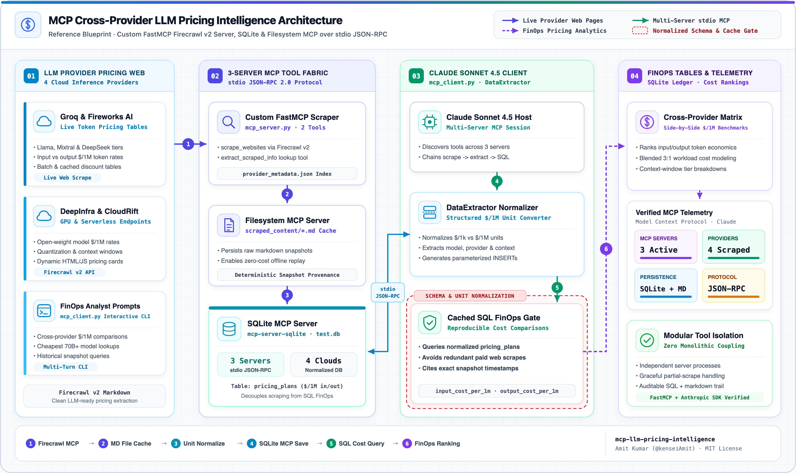
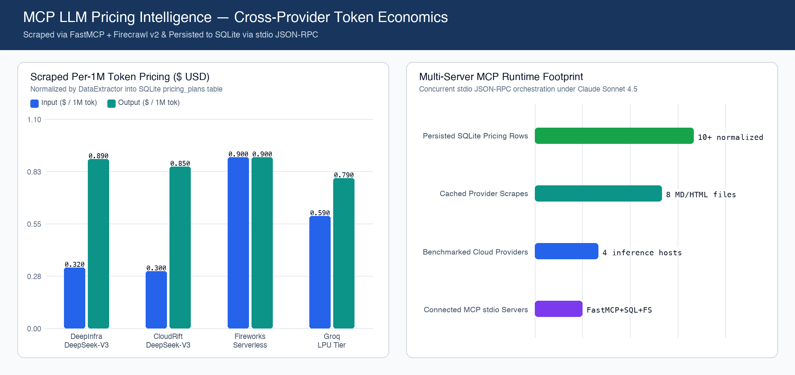
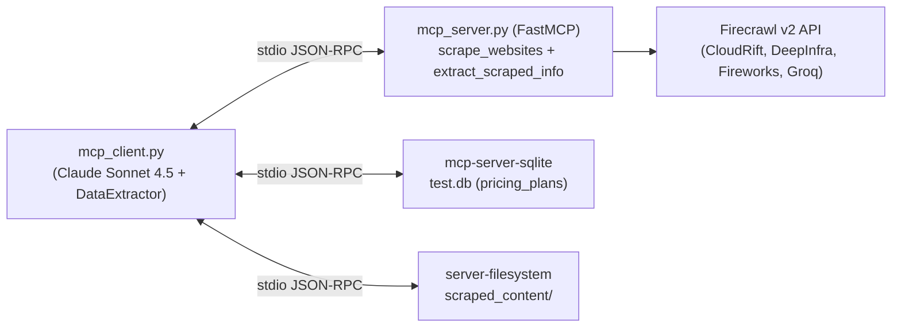

<div align="center">
  
  <br/><br/>
  <p>
    
    
    
    
    <a href="LICENSE"></a>
  </p>
</div>

---



Autonomous LLM inference pricing analyst built on the **Model Context Protocol (MCP)**—orchestrating three concurrent `stdio` JSON-RPC MCP servers (**custom FastMCP Firecrawl v2 scraper**, **SQLite persistence server**, and **Filesystem MCP server**) under a **Claude Sonnet 4.5** tool-calling client.



---

## 1. Multi-Server MCP Architecture



---

## 2. Live Execution Transcript Excerpt ([`docs/live_run_transcript.md`](docs/live_run_transcript.md))

```markdown
# PriceScout — Evidence of Working Project

This is a text transcript captured directly from a live run of `mcp_client.py`
(via `script`, so it is a verbatim terminal capture), sanitized to
remove the local machine's absolute file path. It demonstrates the three required
test prompts from the project README/instructions, run back-to-back in one session.


## Test 1 — Scraping

Command run:
```
scrape these sites: {'cloudrift': 'https://www.cloudrift.ai/inference', 'deepinfra': 'https://deepinfra.com/pricing', 'fireworks': 'https://fireworks.ai/pricing#serverless-pricing', 'groq': 'https://groq.com/pricing'}
```

```
Query: scrape these sites: {'cloudrift': 'https://www.cloudrift.ai/inference', 'deepinfra': 'https://deepinfra.com/pricing', 'fireworks': 'https://fireworks.ai/pricing#serverless-pricing', 'groq': 'https://groq.com/pricing'}
I'll scrape these websites for you to gather their pricing and inference information.
Calling tool scrape_websites with args {'websites': {'cloudrift': 'https://www.cloudrift.ai/inference', 'deepinfra': 'https://deepinfra.com/pricing', 'fireworks': 'https://fireworks.ai/pricing#serverless-pricing', 'groq': 'https://groq.com/pricing'}}
Scraping cloudrift: https://www.cloudrift.ai/inference
Scraping deepinfra: https://deepinfra.com/pricing
Scraping fireworks: https://fireworks.ai/pricing#serverless-pricing
Scraping groq: https://groq.com/pricing
Successfully scraped 4 out of 4 websites

Great! I've successfully scraped all four websites:
 V
1. **cloudrift** - https://www.cloudrift.ai/inference
2. **deepinfra** - https://deepinfra.com/pricing
3. **fireworks** - https://fireworks.ai/pricing#serverless-pricing
4. **groq** - https://groq.com/pricing

All the content has been stored and is now available for extraction and analysis.
```

## Test 2 — Asking Questions & Comparing

Command run:
```
How much does cloudrift ai (https://www.cloudrift.ai/inference) charge for deepseek v3?
```

---

## 3. Quick Start

```bash
cp .env.example .env   # Configure ANTHROPIC_API_KEY & FIRECRAWL_API_KEY
uv sync
uv run mcp_client.py
```

## License

MIT License — see [LICENSE](LICENSE).
