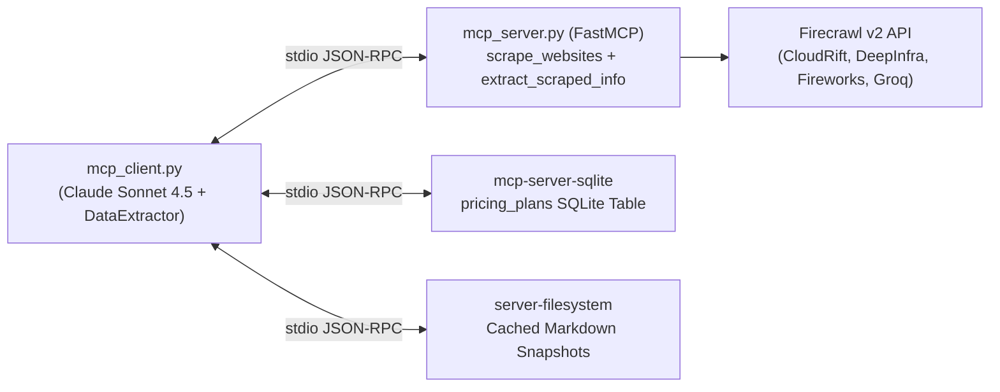

# MCP LLM Inference Pricing Intelligence Agent

Autonomous LLM inference market-intelligence agent built on the **Model Context Protocol (MCP)** and **Claude Sonnet 4.5**—coordinating three concurrent `stdio` JSON-RPC MCP servers (**custom FastMCP Firecrawl scraper**, **SQLite persistence server**, and **Filesystem MCP server**) to crawl, normalize, persist, and compare real-time per-million-token pricing across cloud inference providers.

---

## Multi-Server MCP Topology



---

## Key Capabilities & Verified Execution Artifacts

- **Custom FastMCP Scraping Server (`mcp_server.py`)**: Exposes `scrape_websites` (live Firecrawl v2 Markdown/HTML extraction + metadata registry `scraped_metadata.json`) and `extract_scraped_info` for targeted provider lookup.
- **Automated Relational Normalization (`mcp_client.py` `DataExtractor` + `test.db`)**: Parses unstructured multi-provider pricing answers into structured SQLite rows (`provider_name`, `model_name`, `input_price`, `output_price`, `cached_input_price`, `context_window`) queryable interactively via `show data`.
- **Verified Live Provider Corpus & Run Transcript**: Cached real scrapes across **CloudRift**, **DeepInfra**, **Fireworks AI**, and **Groq** in [`scraped_content/`](scraped_content/) and full multi-turn tool-call execution trace in [`docs/live_run_transcript.md`](docs/live_run_transcript.md) (comparing DeepSeek V3/V4 & Qwen series input/output token economics).

---

## Quick Start

```bash
cp .env.example .env   # Configure ANTHROPIC_API_KEY and FIRECRAWL_API_KEY
uv sync

# Launch the interactive multi-server MCP pricing analyst
uv run mcp_client.py
```

## License

MIT License — see [LICENSE](LICENSE).
